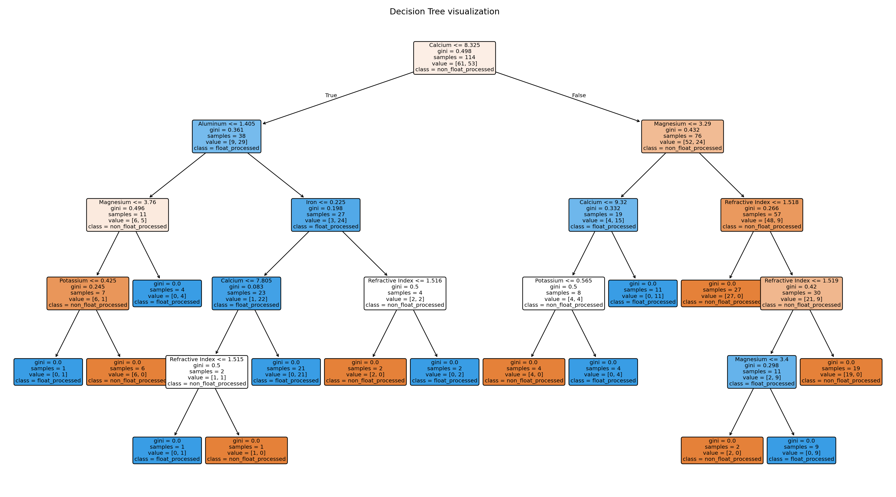

# Classifying glass with decision trees

This study classifies window glass from its chemical features. It compares split criteria and tree depths across several train/test splits, plots feature importance and traces a prediction through the fitted tree. Comparing the settings on test splits makes the reported scores exploratory.

## Run

```sh
python -m pip install -r requirements.txt
python classify.py
```

Run the commands in the repository root. The script fetches the glass2 dataset from PMLB and can reconstruct a binary dataset from UCI if that request fails. Internet access is required for the data. Run the notebook in Jupyter to step through the original experiment. The script also generates the extended tree visualization using Matplotlib when optional dtreeviz rendering is unavailable.

[Parameter comparison](parameter_results.csv) · [PMLB glass2](https://github.com/EpistasisLab/pmlb/tree/master/datasets/glass2) · [UCI Glass Identification](https://archive.ics.uci.edu/dataset/42/glass+identification)


